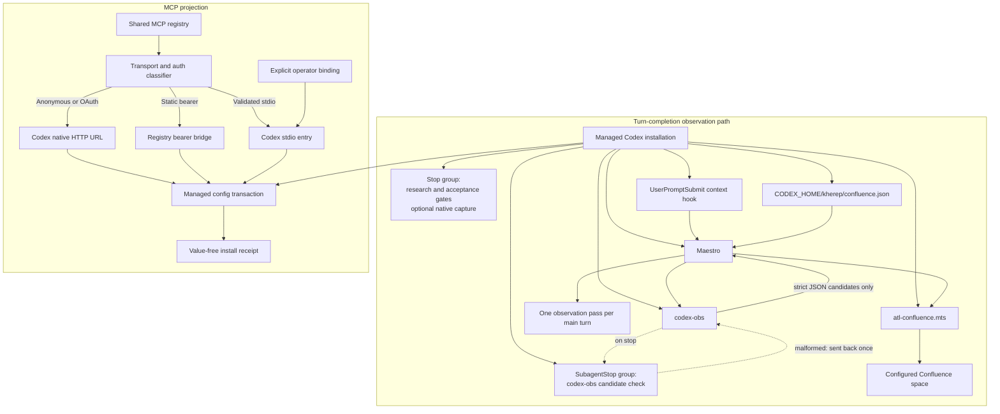

# Codex adapter architecture

The Codex adapter projects shared Kherep capabilities into a separate Codex configuration. It does not copy credentials into its receipt or managed native HTTP entries.

## Memory backends

Memory is unconfigured. The only accepted explicit `InstallOptions.memoryProvider` or `--memory-provider-config` selection is `{ "provider": "unconfigured" }`; the installer persists it in `orchestra/memory-provider.json`. Shared knowledge is the Central Brain: a dedicated Confluence space that `codex-obs` candidates reach through the trusted Maestro and the service-account broker (see turn-completion observations below). Invalid selections stop installation.

The earlier `central-brain` MCP backend is retired. An explicit selection of it is refused. A persisted selection is reported as `retiredMemoryProvider` in the receipt and replaced by the unconfigured selection, with the previous file in the installation backup. Its path references are used only to rebuild the managed block the old installer wrote (`lib/retired-central-brain.mts`), so that exact block, including its MCP table and native hooks, is recognised as managed and replaced. Any other block is refused, not overwritten.

The Maestro context hook emits routing and safety reminders. It does not forward prompt or turn content. Generic CLI execution and exact plugin-table updates live in `lib/codex-cli.mts` and `lib/plugin-config.mts`; local Maestro registration uses these helpers. The optional Atlassian tool set adds the v2 Atlassian remote MCP server (`atlassian`, `https://mcp.atlassian.com/v2/mcp`) to the managed block as a stdio table that runs the secret-file wrapper with the Codex service account's API key file (`lib/atlassian-mcp.mts`, issue #376); the v1 `rovo` table and the earlier native OAuth url table are retired. Custom configuration, unrelated plugins and the computer-use notify wrapper remain intact. Only the exact owned retired notify is detached. File retirement uses the existing reversible install transaction. Original integration artifacts and historical evidence are preserved externally, outside the publishable tree.

Existing reminders and acceptance hooks remain configured. Every managed hook also carries `commandWindows`, the same command behind the PowerShell call operator `&`, because Codex on Windows runs a hook through `pwsh -NoProfile -Command`, where a command that starts with a quoted path does not parse. Historical renderers keep their original bytes, including the retired native hook commands and the blocks without `commandWindows`, so upgrades recognize exact prior blocks. The receipt establishes configuration only. Current Codex hook trust and feature policies must allow execution at the actual host; Desktop execution remains UNKNOWN until independently measured. `prepared` and `injected_port_prepared` describe prepared output, not native delivery or model use.

## Agent model resolution

`codex/parity/model-policy.toml` defines versionless role families and reasoning defaults. Astra is the default main designer, SOL implements and coordinates the root, Terra handles support and research, and Luna handles observations and broker work. The `feature-dev` code architect maps to the designer before generic plugin mappings. Actual plugin names, including personal-name collision renames, are recorded with their role, concrete model and reasoning in `projection.agentDefaults`.

The synchronous installer performs `lib/model-install-state.mts` preflight before transactions or runtime calls. It reads only the canonical `orchestra/parity-receipt.json` for an earlier `modelResolution`; a missing resolution requires a complete injected catalog, while an unreadable or inconsistent receipt fails closed. Ordinary reinstall validates and retains the existing resolution. A changed policy or newer catalog requires explicit `--refresh-models`. The async CLI entry point uses an injectable catalog reader only for the first resolution or that explicit refresh. Top-level operator model and reasoning settings retain the existing preservation behavior.

`lib/model-catalog-process.mts` launches one owned Codex app-server through the existing binary and process helpers. `lib/model-catalog.mts` runs initialize/initialized and exhausts visible `model/list` pagination with bounded requests. It starts no threads or inference. Cleanup requires exit/close and owned-group or tree disappearance; unavailable cleanup evidence fails the read. Returned metadata is reconstructed from a whitelist at the catalog, model and reasoning levels. Errors crossing the process reader boundary contain no raw RPC errors, account details or stderr.

`lib/model-policy.mts` selects the numerically newest exact family member supporting the requested reasoning, rejecting hidden, preview, dated or ambiguous matches. The same resolution renders native agent TOMLs and the plugin-aware `hooks/parity/capabilities.json` snapshot, written after projection determines all managed names. The transaction also installs the policy at `orchestra/model-policy.toml`. Receipt evidence includes exact policy-file SHA-256, sanitized catalog hash and resolution time. Rollback restores native TOMLs, dispatch snapshot and receipt together.

The dispatch guard reads this installed snapshot without network calls. Known projected agents have measured defaults, so explicit overrides are checked with any remaining inherited agent field. Generic or unknown agents may inherit natively without overrides; a partial override requires both fields explicitly because policy-root defaults do not establish the active parent's settings. Complete explicit pairs are checked against the exact model's supported reasoning. The observation model pin remains exact, including when a dispatch omits its model. Tests cover synthetic installation and process ports; they do not establish native Desktop or Windows activation.

## Research enforcement

The managed `UserPromptSubmit` group runs `codex-research-first.mts` beside the Maestro context hook. It emits only a fixed evidence-first instruction, the configured workspace's quoted Codex broker path, and a validated space key or a fixed configuration pointer. It never echoes the prompt. The managed `Stop` group runs `codex-research-stop.mts` with the acceptance gate. On a substantial current turn, the research hook requires a structured Central Brain lookup attempt and, after a detected repository edit, a codebase-memory call. Its fixed feedback names only the missing Brain attempt, graph attempt or both, without asserting an outage. The parser, 400-character and three-read-only-call thresholds remain unchanged. A final `[research: none - <reason>]` with a nonempty reason is the explicit opt-out. `stop_hook_active` must be exactly false, so the continuation can occur only once.

The prompt context also describes command-scoped approval for a read-only broker search blocked by sandbox networking. Headless callers opt into review with `codex exec --approve-for-me`; the agent can then request `sandbox_permissions="require_escalated"` for that command. The reminder grants no permission, changes no sandbox configuration, and does not infer a service outage from `status: unavailable`. See the [headless research invocation](../docs/CODEX.md#evidence-first-research-hook).

The parser reads the local Codex rollout named by the Stop payload and emits no transcript content. It prefers a matching `turn_id` and `task_started` boundary, then reads `response_item` messages, `function_call` and `custom_tool_call` records. Direct codebase-memory names accept the hyphenated and underscored server forms. For `functions.exec`, a local lexer recognizes actual `tools.*(...)` call syntax while excluding strings, comments, template literals and regular-expression literals in its supported JavaScript contexts. Dynamically constructed JavaScript remains outside this classifier. This is syntactic evidence of an attempted nested call. It cannot prove that a conditional branch executed or that the lookup succeeded. Repository edits are recognized from `apply_patch`, the explicit file-write tools and common shell mutation commands. Arbitrary programs can mutate code without a locally recognizable command, so that path remains unenforced.

Codex documents the rollout transcript as unstable. A missing or relative path, a Claude-private path, an unreadable file, an unknown current-turn boundary or a wholly unrecognized record shape is undecidable and fails open. A malformed trailing line is ignored when earlier records still establish the requested current turn. The hook prints only a fixed continuation reason and performs no network request. Codex Stop precedence also matters: any matching hook that returns `continue: false`, including the acceptance gate, takes precedence over a research `decision: "block"`. Research continuation is therefore effective when the acceptance gate allows the turn to stop. The research parity check covers only the two named Claude and Codex research hook counterparts; it is not a claim of generic runtime parity.

The current installer recognizes the exact managed block from immediately before these two hooks and replaces it transactionally. That upgrade support is separate from live execution: repository tests and an installed config establish projection, while actual Desktop discovery and one observed continuation are still UNKNOWN until checked on each target host.

## Patch privacy input

The hook adapter expands a framed `apply_patch` input into explicit file operations before `pre-privacy` evaluation. It accepts a raw patch string or an `input`/`patch`/`command` wrapper and checks every add, update, delete and move target. Ambiguous headers or missing targets retain a denied file-tool shape. The normalized input keeps the full original payload and a content view without diff prefixes, so protected paths in added/removed content remain visible to the existing privacy evaluator. The privacy guard, shell handling and best-effort post-hook scanner are unchanged.

In the PreToolUse phases (`pre`, `pre-no-transcript`, `pre-privacy`, and `pre-intent` with the differences at the end of this paragraph) the adapter answers a wrapped guard's exit 2 with the documented Codex deny on stdout, `{"hookSpecificOutput":{"hookEventName":"PreToolUse","permissionDecision":"deny","permissionDecisionReason":"..."}}`, and exits 0. The reason is the guard's trimmed stderr, or a fixed text naming the guard when stderr is empty. Codex blocks only on exit 2 with a stderr reason or on that JSON with exit 0, and on Windows it runs `commandWindows` under pwsh, which reports a native exit 2 as 1, a non-blocking failure. The first blocking item of a multi-command payload answers alone; nothing after it runs, and output earlier items wrote to stdout is dropped so the deny stays the only JSON document. A guard's own JSON on exit 0 passes through, any other exit keeps its code, and the PostToolUse `post` phase is unchanged (issue #258). The phase `pre-intent` (issue #538) carries the messaging intent hook: its deny reasons are fixed text with the basename and the installer as repair path, the guard's stderr is not forwarded, and its allow passes only with `updatedInput` equal to the call's `tool_input` plus a UUID `requestId`.

## Post-edit dispatcher

The managed `PostToolUse` group for `Edit|Write|MultiEdit|apply_patch|functions\.exec` contains one command, `codex-post-edit-checks.mts`. The dispatcher calls the existing post normalization unchanged, then starts the four byte-identical shared watchers as sibling Node processes with JSON on stdin: `manifest-watch.mts`, `loc-watch.mts`, `umlaut-translit-watch.mts` and `simplify-nudge.mts`. A direct edit produces four children, and each recognized add, update or delete patch target produces four children. Move destinations remain visible in the patch text but are not claimed as normalized post targets. A normalized `Bash` item starts no watchers: all four shared sources reject that tool before inspecting input. Contract tests pin this behavior with inputs that would produce edit findings. The dispatcher still starts at the native return point; shell commands are not classified as read-only to obtain this saving.

One narrow exception avoids the four watcher processes for a `functions.exec` wrapper that is completely consumed as a sequence of direct `tools.Name(<literal>)` statements, optionally prefixed by `await`, where every exact tool name belongs to the explicit Codebase Memory read-only set. Literal objects and arrays are supported, including simple unquoted property names. Variables, spreads, getters, methods, computed properties, interpolated templates, nested calls, multiple arguments, dynamic tool names, wrappers and malformed or empty source do not qualify. There are no MCP wildcards, fetch-name rules or shell-prefix exemptions. Any unknown or mixed wrapper takes the conservative path through the original payload; recognized patch targets are retained, and `Bash` is the fallback only when normalization finds none.

Plain watcher findings become `additionalContext`. Valid watcher JSON keeps its `hookSpecificOutput.additionalContext` and `systemMessage`. The dispatcher emits exactly one `PostToolUse` JSON document when any finding exists and nothing for an all-green run. Child stderr, a nonzero exit, process errors, signals and malformed structured output remain visible as failures.

The installer copies the dispatcher, its literal classifier, the existing hook adapter and research lexer, all four watcher sources and their shared dependencies into the Codex hook directory. The adapter is copied byte-identically under both `codex-hook-adapter.mts` for existing commands and `hook-adapter.mts` for the dispatcher's import. Its three modules (`hook-adapter-payload.mts`, `hook-adapter-verdict.mts`, `hook-adapter-run.mts`, issue #533) are copied once under their own names; both copies import the same files. The existing integrity check maps that alias and the classifier back to their Codex sources. An exact predecessor with four hook commands is migrated to the one-command group; custom groups and hook state tables remain byte-preserved. No trusted hash is minted or moved. One-line predecessor drift is refused. Isolated installation tests execute the installed dispatcher and measure recovery of a damaged adapter alias. These statements describe configured source and repository tests. Actual Codex Desktop execution and latency remain UNKNOWN until measured after separate activation.

## Quiet peer-message feedback

The installer also projects an independent synchronous native `PostToolUse`
delivery group for busy original-owner turns. Authorized CP admission
publishes a bounded metadata ticket directly, without a native queue submission
or spending autonomous-turn budget.
The native owner gate excludes children before local storage reads, and fresh
policy plus at most eight current records control its claim. A persisted claim
emits one compact `additionalContext` hint in the original owner's running turn
at the next supported tool boundary. No peer body, path or receive command
appears in it, and it does not interrupt sampling. With `wake.nativeQueue: true`
(off by default, issue #429), a separate guarded native Queue pointer waits while
active and can wake the same idle loaded owner. Existing
receive/confirmation paths still own offers and receipts; admission and claim
leave content accepted in the persistent CP Inbox. Quiet failures retain that
content. Normal Stop confirms offered content and awaits bounded reconciliation
of exact native pointer groups whose entire batch is delivered. List/delete and
complete readback use the captured local producer identity; attempts remain as
the duplicate barrier. Late settlement and existing poll rounds recover pending
cleanup. Offered and foreign cards remain untouched; already-started turns are
never interrupted. See the [Control Plane contract](../modules/control-plane/ARCHITECTURE.md#codex-busy-turn-hint-admission).

Exact predecessor renders retain their bytes. The upgrade checks external
PostToolUse group positions after verified managed-tail reanchoring and refuses
an index shift before writes. It never generates trust hashes. Each host must
review the new native definition and establish actual active-turn acceptance.

The Codex delivery adapter supplies the exact session-bound receive recipe at SessionStart and every UserPromptSubmit, including empty and foreign-only inboxes. Recipe bytes share the existing bounded developer context with framed peer content. SessionStart recipe output alone does not offer a message. The Stop reason is one fixed short cue, without CLI commands, paths, identifiers, escalation text or peer content. Explicit receive and the following confirming turn retain the existing accepted, offered and delivered transitions; continuation, permission and budget guards are unchanged.

Receive context and short Stop presentation are pinned as separate A/B source artifacts. Updating a checkout referenced by a live hook can change its behavior without an installer. Before stage B is activated, every affected running owner must cross an actual stage-A context boundary and finish any pre-A turn. Source merge and component tests do not establish that target cutover. See the [existing-owner acceptance plan](../docs/superpowers/plans/2026-10-10-codex-quiet-owner-cutover.md).

The Agent, web and MCP `PreToolUse` group ends with `atlassian-destructive-guard.mts --runtime codex` (issue #376), run through the fail-closed hook adapter since issue #507 part 4 (`codex-hook-adapter.mts <guard> pre --runtime codex`; the adapter passes the arguments after the phase to the guard). It denies every `mcp__<server>__executeDestructive` call through JSON on stdout, because Codex hooks cannot ask the operator; it is an entry of the existing group, not a group of its own, because a new group would move the positional trust key of every operator `PreToolUse` group after the managed block. Whether Codex fires `PreToolUse` for an MCP call nested in `functions.exec` is unverified. The managed Atlassian table's `approval_mode = "prompt"` is the second layer for that case; whether Codex honours it under every `approval_policy` is unverified as well.

The shell `PreToolUse` group runs one `codex-shell-checks.mts` command (issue #386). Its attribution argument is the stable entry point `codex-control-plane-hook.mts` (issue #503): after every guard the dispatcher imports it, resolves the attribution hook through the source record and calls it in-process, inside its own `try`, so a missing record never skips a guard or changes a deny. It invokes `commit-guard.mts`, `deploy-guard.mts` and `main-checkout-guard.mts` through the exported adapter runner, retaining their child processes and original phase-specific normalization (`pre`, `pre-no-transcript`, `pre`). Privacy stays independent; Playwright and the dispatch-contract guard keep their own groups, each one adapter entry since issue #507 part 4. Every guard runs even when another denies. The first deny is the sole stdout JSON document. Missing, empty, unloadable, signalled, timed-out or unsuccessful guards also produce that native JSON deny with exit 0, including under PowerShell. Each guard retains the predecessor's ten-second execution allowance across normalized inputs; the dispatcher has a 40-second native timeout. Since issue #507 part 4 one integer clock ends 1.5 seconds before it and bounds stdin, the guards, journal capture and the hook integrity re-check; attribution runs after the re-check, uncapped, so the answer has no end-to-end deadline. `main-checkout-guard.mts` refuses branch switches, detached checkout and branch creation in a workspace repository's main checkout, while retaining its file-checkout and linked-worktree exceptions and shared token walk.

In the [Codex runner at `17a0e6f`](https://github.com/openai/codex/blob/17a0e6f63fad13f577ef87b36b4ea37fc06385e9/codex-rs/hooks/src/engine/command_runner.rs#L332-L340), timeout discards stdout and returns an error. The [PreToolUse parser](https://github.com/openai/codex/blob/17a0e6f63fad13f577ef87b36b4ea37fc06385e9/codex-rs/hooks/src/events/pre_tool_use.rs#L193-L211) records errors without setting `should_block`; the [core runtime](https://github.com/openai/codex/blob/17a0e6f63fad13f577ef87b36b4ea37fc06385e9/codex-rs/core/src/hook_runtime.rs#L223-L225) continues if the aggregate does not block. Thus a written deny can be lost when this hook times out in that revision; independent guards may still block. Installed Desktop equivalence remains UNKNOWN until measured.

The attribution implementation (issue #325) stays in the checkout. The shell dispatcher receives its absolute path as an argument and calls `handleAttributionHook` in-process with the original payload and Codex runtime, after all guards. Attribution remains nonblocking and leaves the same owner-bound pending marker for `git push` and `gh pr create`; Git's `pre-push` hook consumes it. Its direct `PostToolUse` group still records `gh pr create`. Checkout retargeting updates the dispatcher argument as well as the direct post and delivery commands. External delivery ownership suppresses only duplicate intake groups; both attribution paths remain. Exact predecessor renders keep their old bytes. Upgrade replaces only the shell group's entries, retains all group positions and operator state bytes, refuses unknown drift and never mints trust. The changed dispatcher definition needs host review; stale hashes do not activate it. See [measured hook starts and host acceptance](../docs/CODEX-HOOK-RUNS.md).

Denied calls (issue #504): after its guards, the adapter's `main()` journals the per-item verdicts of a delegated call (a payload with a valid `agent_id`) through `lib/denial-journal.mts` beside the installed copy, in parallel with the re-check, and the shell dispatcher journals every denying guard before its re-check; the lib retains its 600 ms cap, and the capture-failed marker is attempted when the lib or the write fails. The standalone adapter awaits that marker until the deadline less 250 ms before `process.exit(0)` (issue #612). The shell dispatcher gives the lib and marker a shared maximum of 2 seconds, shortened to the remaining deadline less 250 ms, also when the adapter cannot load (issue #621). Its CLI waits for stdout and stderr callbacks, even for empty output, then exits with code 0; exported `shellChecks()` never exits the caller. With the full capture window and prompt scheduling, a marker settling 700 ms after the lib timeout persists, but writes still pending at the cap may be lost: capture is not guaranteed. Attribution remains uncapped, so there is no unconditional 40-second answer guarantee. Neither path changes the decision. `runAdaptedHook()` never journals. Codex documents no `agent_id` on a child's `PreToolUse`, so capture is inert until a child-thread key is measured (#537). The lib is loaded by a computed path and registered for both adapter copies in `hook-integrity-sources.mts`, so the integrity hook inventories and restores it. The installer copies the renderer `claude/hooks/denied-calls.mts` to `hooks/kherep-maestro/denied-calls.mts`. No hook group is added.

## Hook integrity

`hooks/hook-integrity.mts` is installed as `<CODEX_HOME>/hooks/kherep-maestro/codex-hook-integrity.mts` and runs as the last entry of the Maestro `SessionStart` group with `timeout = 30`. It is appended after the optional native hook because Codex trust keys are positional: every earlier entry keeps its index and its trust. It is the Codex counterpart of `claude/hooks/live-hook-integrity.mts`, which only runs when a Claude session starts.

It reads every `command` of every `[[hooks.<event>.hooks]]` table in `config.toml`, decodes it as a TOML basic string (a literal string is taken raw), and keeps the double-quoted `.mts` and `.js` parts under `<CODEX_HOME>/hooks`. To those it adds their relative import closure through `claude/hooks/lib/hook-inventory.mts`, resolved from each file's real path, plus the libs `codex-privacy-boundary-guard.mts` loads through a computed `require` (`workspace-scope`, `private-path-policy`, `private-path-rules`, `real-path-policy`) and the one `codex-dispatch-contract-guard.mts` loads the same way (`obs-brief-policy`), and `guard-recheck`, which both adapter copies and `codex-shell-checks.mts` load by a computed path, and `denial-journal`, which both adapter copies load that way (issue #504). The computed child edges for `codex-shell-checks.mts` also include the three shell guards and their import closure, so consolidation retains guard recovery. Each file is OK, broken (absent, 0 bytes, rejected by `lib/hook-syntax.mts`) or unchecked. A broken file is restored from the source root of `<CODEX_HOME>/orchestra/control-plane-source.json` (issue #503, accepted only after the same shape check the entry point applies), else from the checkout an older control-plane deliver-hook command names, else from `lib/orchestra-checkout.mts`: `lib/<x>` from `claude/hooks/lib/<x>`, a shared guard from `claude/hooks/<name>`, `codex-<name>.mts` from `codex/hooks/<name>.mts`, the Codex helpers and `kherep-maestro-context.mts` from `codex/hooks`. The write goes through `lib/restore-write.mts`. A restore counts only when a re-read of the target has a size above 0 and the SHA-256 of the checkout bytes. The two observation hooks are rendered by the installer, so a broken one is reported with the hint to rerun `codex/install.mts`. Without a checkout nothing is written. Every finding is appended to `<CODEX_HOME>/.cache/hook-integrity/incidents.jsonl`, with the fields of the Claude journal.

Its own eight libs are loaded with a dynamic `import()` from `./lib` beside the installed file, else from the checkout's `claude/hooks/lib`, in dependency order: `workspace-scope`, `orchestra-checkout`, `restore-write`, `integrity-heartbeat`, `hook-inventory`, `hook-syntax`, `integrity-verdict`, `integrity-passes`; each used export must be a function. A lib that does not load is reported as kind `self`; it is restored only when the first four loaded (`RESTORE_LIBS = 4`), because the restore needs the run lock from `integrity-heartbeat`. Its two own modules (issue #533) load as steps five and six, right after those four, from beside the running file into a namespace of their own (`integrity-verdict` exports a `restore` and a `journal` too), with their source in `codex/hooks/`: first `hook-integrity-repair.mts` (the checkout, the measured restore, the journal, the check of one file), then `hook-integrity-sources.mts` (what is checked beyond the closure and where each installed file comes from). A broken sources module is reported as kind `self` and restored; a broken repair module is reported with `the restore itself needs hook-integrity-repair.mts` and needs a reinstall, like the four restore libs. That widens the reinstall-only set by one file whose code was moved out of `hook-integrity.mts`, which is reinstall-only itself, so no restorable path became non-restorable.

Codex has no hook runtime (issue #507, part 3), so before anything is restored or journalled the hook takes `run.lock`: an EXCLUSIVE SQLite transaction on `<CODEX_HOME>/.cache/hook-integrity/run.lock.sqlite`, released by the operating system with the process. A busy answer is retried three times, 2 to 11 ms apart on the same connection (issue #620: two runs starting together could each see the other's transient SQLite lock and both back off, so nobody repaired); without the lock after that, the hook reports `busy, holder UNKNOWN` and changes nothing. On a `run.lock.sqlite` the process can read but not write, SQLite opens the file read-only and `BEGIN EXCLUSIVE` there excludes nothing, so the hook writes `PRAGMA user_version = 0` inside the transaction, which it never commits; such a file is refused as `run.lock unavailable (ERR_SQLITE_ERROR)` and nothing is changed. It removes the heartbeat before its first repair, repeats the walk after each repair pass (`lib/integrity-passes.mts repairPasses`, at most three), walks the live closure once more read-only (`finalPass`), and only when all of that passed writes `<CODEX_HOME>/.cache/hook-integrity/heartbeat.json` (temporary file and rename). Since part 4 the heartbeat also holds `peers`: for each of `codex-hook-adapter.mts`, `hook-adapter.mts` and `codex-shell-checks.mts` its device, inode, size and modification time in nanoseconds (decimal strings) and the SHA-256 of the bytes, taken by `lib/integrity-heartbeat.mts provenPeer` from an fd-bound snapshot of exactly the bytes the final pass judged; a file whose verdict is not OK, or whose path no longer names those bytes after the verdict, gets no record. That record is the proof the dispatchers' peer check relies on: the adapter compares `codex-shell-checks.mts` with it, the shell dispatcher both adapter copies, by one stat each, and a difference or a missing record starts a re-check. The other wired files keep the limit that the Codex final pass binds no snapshot.

The hook runs with three triggers: `session-start` (its `SessionStart` entry), and `--trigger hook-adapter` and `--trigger codex-shell-checks`, the re-checks the adapter and the shell dispatcher start after their guards when the heartbeat is older than 30 minutes or missing, a guard could not run, or a peer changed. With `--trigger` it prints plain lines instead of the `SessionStart` JSON. As a `SessionStart` hook it is silent when everything is OK; otherwise it prints one JSON document with `systemMessage` and `hookSpecificOutput.additionalContext`. A Codex `SessionStart` hook cannot block, so it always exits 0. The installer recognizes the exact managed block from immediately before this hook and replaces it; Codex then asks to review exactly the one new hook.

## Turn-completion observations

Both hosts project the research and acceptance `Stop` hooks. The `UserPromptSubmit` Maestro context hook supplies a quiet per-turn instruction to dispatch `codex-obs` once before final. Previous macOS combined and Windows separate observation Stop blocks are recognized as managed and replaced during reinstall. Their old script files may remain installed but are not configured, so they cannot produce user-visible observation continuation prompts.

The normal projection installs the `codex-obs` role from `codex/agents/codex-obs.md` and the twelve-file minimal Codex service-account Confluence graph. That graph consists of `atl-confluence.mts`, the shared `atlassian-credentials.mts` parser, the shared `atlassian-cli-args.mts` argument parser and nine Confluence modules: contract, content, session, related, semantic, neighbours, neighbour CLI, runtime label and label CLI. The Maestro sends only a bounded nonprivate summary to the worker with `fork_turns: "none"`. The installer writes the resolved capabilities snapshot to `hooks/parity/capabilities.json` in the Codex home, beside the `hooks/kherep-maestro` directory that holds the dispatch guard. The guard reads the `codex-obs` model pin from that file and denies a dispatch of that agent without the pinned model. It also denies a `codex-obs` message that is not a well-formed observation brief, checked by `claude/hooks/lib/obs-brief-policy.mts` from the installed `lib` sibling (issue #331). An allowed `codex-obs` dispatch whose brief gives a code-bound finding no exact `<name>@<sha>` binding gets a revision notice as PreToolUse `additionalContext` and `systemMessage`, never a permission decision; an installed lib without `observationBriefNotice` gives no notice and no deny (issue #505). The worker returns strict JSON candidates and performs no configuration or broker I/O. Its projected `sandbox_mode = "read-only"` prevents worker filesystem writes; restricted subagent execution withholds the Maestro's escalated network authority. The candidate envelope includes `title`, `bodyStorage`, `evidence`, `labels` and `placement`. The Maestro validates it, checks canonical publishing authority, and uses the Codex service-account broker for related search, create/readback and stitch. Empty `observations` means zero writes. The context hook forwards no prompt or transcript content.

The `SubagentStop` group with matcher `codex-obs` (issue #326) runs `hooks/kherep-maestro/codex-obs-result-check.mts` directly, not through the adapter. It checks the worker's last message, or the final assistant text of the rollout at `agent_transcript_path` when `last_assistant_message` is null, with `obs-candidate-policy.mts`: one strict JSON document, an `observations` array as its only key, and per candidate exactly the five fields, one of the four evidence values, the three base labels and a non-empty `project` and `app`. On a `confirmed` candidate every `Revision:` line its body carries must be `<repo>@<full commit sha>` without a dirty or no-binding suffix (issue #505); that is a shape check of a line the worker chose to write, not proof that a published page carries it or that it belongs to the finding. A Markdown fence is malformed. A valid candidate, empty or not, is silent. A malformed one gets one `{"decision":"block"}` with a fixed reason, which Codex delivers to the worker as a continuation; with `stop_hook_active` not exactly false it gets a `systemMessage` only, so the hook never loops. A result it cannot see and any hook error are a one-line `systemMessage`, exit 0. Codex requires JSON on stdout when a hook exits 0, so the hook prints one JSON document or nothing, and nothing it prints is taken from the message, the rollout or the payload. The Codex candidate has no `failed` status: the worker performs no broker I/O, and a failed publish is the Maestro's to report. The group is the last hook group of the block, after the deliver groups and the optional native `SessionEnd`; Codex trust keys are positional per event, so no existing key moves, and the installer recognizes the exact managed block from immediately before it. The hook imports `obs-candidate-policy.mts` and `research-transcript.mts`, both copied from `codex/hooks`, and the integrity check restores them from there.

The canonical host target is `<CODEX_HOME>/kherep/confluence.json`. On migration, `orchestra/confluence.json` may supply only its `spaceKey`. The setup helper revalidates that key through the Codex `atl-confluence.mts` service-account broker before writing the canonical file, and retains the legacy file. The PowerShell `-AuthorizeObservationPublishing` switch explicitly adds literal `observationPublishingAuthorized: true`. Reinstallation without the switch preserves an existing canonical literal `true` only when the prior canonical `spaceId` equals the newly resolved `spaceId`; a fresh install or changed space identity omits the property, and a legacy file can never supply it. The helper never persists false.

Before a Codex write, the trusted Maestro main thread reads the canonical file and requires the authority property to be literal `true`; absence or any other value produces `publication not authorized` and no write. The value is durable standing authority only for non-secret observation pages in that configured space through the Codex service account. It grants no authority over other spaces, content types, secrets, identities or permissions. The candidate worker cannot publish and does not read configuration. This is a Codex-only split and leaves Claude's direct broker path unchanged. Jira, the v2 Atlassian MCP server and the Claude Jira and Confluence brokers remain optional. Codex and Claude service-account credential bindings remain separate.

Installed source and configuration prove only what was projected. They do not prove that the host trusted or ran the hook, that an automatic observation dispatch occurred, or that Confluence accepted and read back a write. Manual one-observation delivery, a manual `0 observations` result and automatic quiet main-turn dispatch are separate acceptance evidence. Until each is measured at the Windows target, its live status is UNKNOWN.

## MCP projection

Transport and authentication are separate decisions. Credential-free HTTPS endpoints, plus loopback HTTP endpoints, use Codex native HTTP so Codex can perform OAuth when the service requests it. An HTTP source with the exact supported static Bearer header stays behind `registry-http-wrapper.mts`; the credential remains in the private source registry. Other headers and credential-bearing URLs fail closed.

The Central Brain Confluence space is the supported shared knowledge base. Configured unrelated MCP services remain optional and preserve their transport and authorization rules. Obsolete or edited managed configurations require explicit operator recovery when exact ownership cannot be verified.

Two stdio bindings use the secret-file bearer wrapper. The Atlassian one is rendered by the optional Atlassian tool set from the Codex key file (see above) and never from the shared registry, which belongs to Claude. The other product-specific one is the n8n secret-file bearer adapter. A caller supplies its auth file and HTTPS endpoint through `InstallOptions.mcpCompatibility.operatorBindings.n8n`. The installer constructs the Node command and `supergateway-secret-wrapper.mts` arguments. Normal operating-system trust is the default. An existing CA file may be supplied with `caFile`. The mutually exclusive `tlsMode: "legacy-disabled"` preserves an already-authorized per-process compatibility setting only when the caller explicitly requests it.

The Control Plane messaging client is a separate opt-in stdio projection selected through
`InstallOptions.messagingClient` or `--enable-messaging-client`. Its managed table contains the Node
runtime, installed bridge and non-secret config-root paths only. The installer copies the bridge,
intent hook and their public Control Plane dependency graph together. It also renders one exact
PreToolUse matcher for the five messaging tools. The hook supplies updated arguments after durable
intent registration and adds no approval decision. Its entry runs through the hook adapter's
`pre-intent` phase, which denies when the hook cannot run or prints anything but its contract.

The bridge reads current policy and the private credential for every HTTP call, so rotation and
disable take effect without restarting the stdio process. It verifies POSIX ownership and private
mode or the equivalent current-user Windows ACL allowlist before reading credential bytes. It derives the credential-free `/mcp`
endpoint from local node configuration and forwards native JSON-RPC metadata without substitution.
The bearer is confined to the HTTP Authorization header. The normal projection remains free of this
table and hook; client opt-in does not enable the node capability or Worker route.

## Upgrade repair

The installer repairs only exact, owned historical forms. `sourceNames` maps a canonical capability to a differently named private registry source. `legacyServerNames` lists old Codex table names for that capability. `legacyEnvPrefixes` lists explicit old product prefixes and each value must include its trailing underscore, for example `LEGACY_`.

Repairs accept the exact owned environment as either an inline table or Codex's separate `[mcp_servers.<name>.env]` table. Key order and omitted default booleans do not affect ownership validation. Repairs retain private values, disabled state, timeouts, tool policy subtables and unrelated MCP entries. A known legacy source without a validated replacement stays configured and receives `configured-source-repair-required` in the receipt. A later ordinary installer run without compatibility options preserves exact native HTTP, static bearer and n8n entries previously produced by a validated repair.

All writes use the existing install transaction and backup. Rollback restores the prior configuration and managed files.

The Central Brain Confluence space is the supported shared knowledge base. Configured unrelated MCP services remain optional and preserve their transport and authorization rules. Obsolete or edited managed configurations require explicit operator recovery when exact ownership cannot be verified.

## Knowledge-space maintenance

The shared, manually invoked `brain-drainage` skill is projected from `claude/skills/brain-drainage` with its review guide and normal skill discovery. Both runtime service-account broker CLIs expose the same `drainage` command through the installed `confluence-drainage-*` modules and strict `confluence-pagination.mts` helper. The path is Maestro -> configured broker -> GET-only scanner -> bounded candidate report; changes return through operator-reviewed, version-guarded broker updates. No daemon, additional backend or autonomous publication path is installed. Both brokers also expose the read-only `evidence` command (`confluence-evidence.mts`, `confluence-evidence-cli.mts`) for the confirm path: it reads one page, applies the promotion gates offline and writes only local record and body files outside any work tree, never Confluence. Content classification and private local-route constraints precede invocation. See the [broker contract](../modules/atl-jira-brokers/README.md#brain-drainage).
