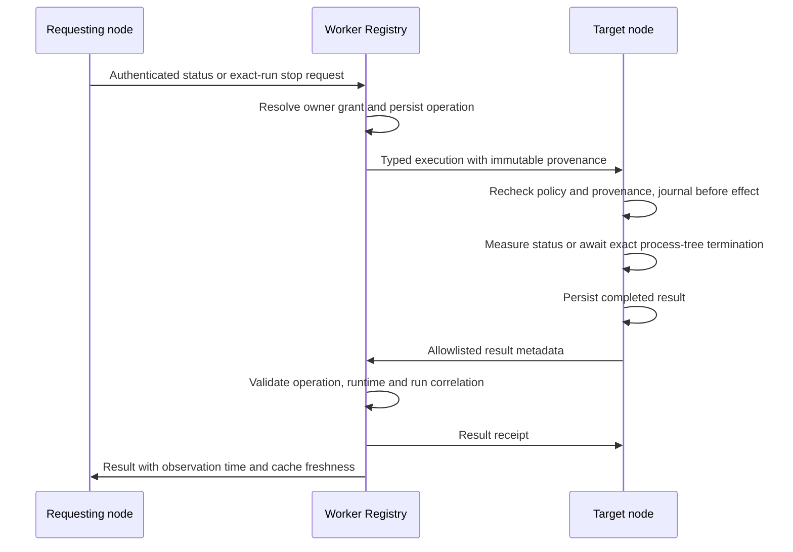
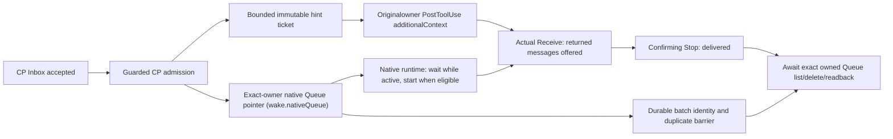
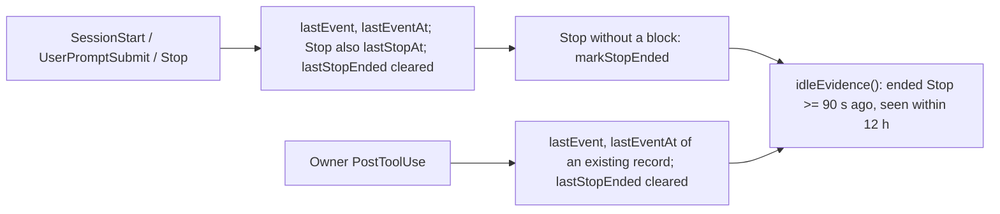
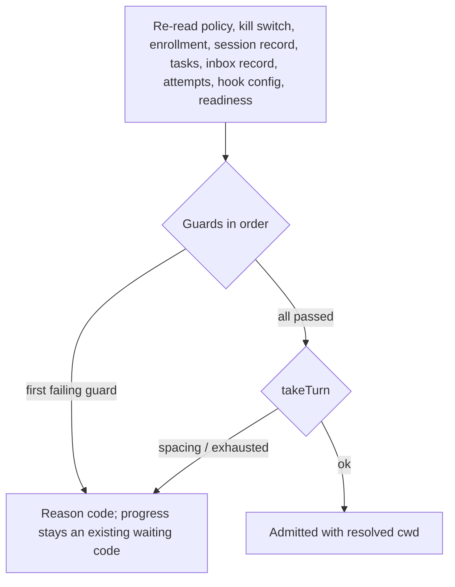
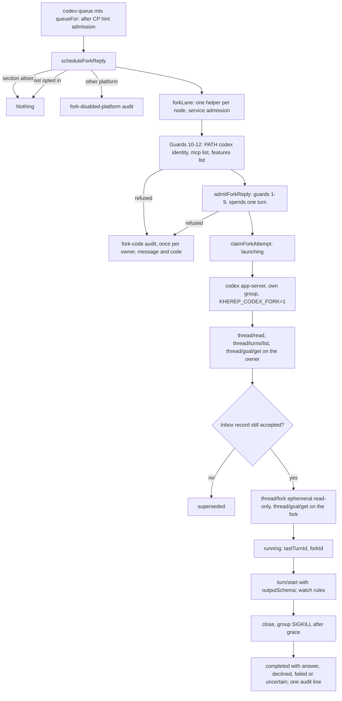
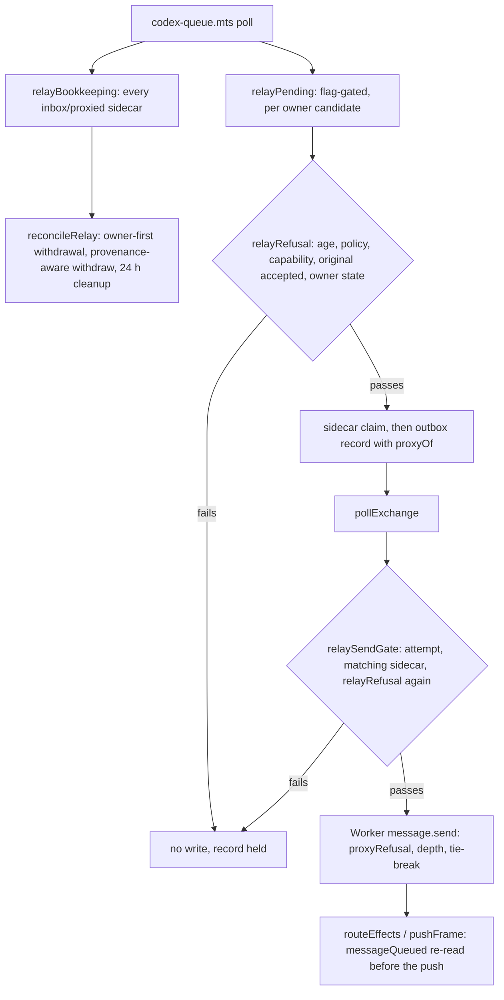
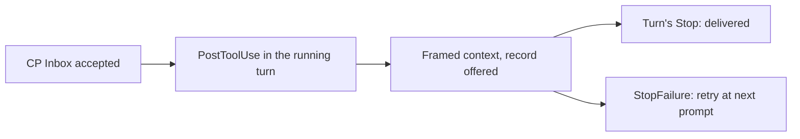

# Control Plane architecture

## Managed daemon service

`node/service-cli.mts` dispatches `service install|upgrade|status|rollback`
before the generic node CLI parser. A clean committed checkout is archived into
an immutable per-user source pin whose full file inventory, Git blob identities,
paths and executable modes reproduce the checkout tree commitment. The service
runner starts the daemon from that pin and `daemon.json` captures its verified
source identity once at startup.

The platform adapters manage only a selected per-user LaunchAgent or Scheduled
Task. Adoption requires the exact service id and validates ownership, privilege,
action shape and execution-affecting environment. Windows task paths retain
nested scheduler folders and backups include both exported XML and the task
security descriptor. macOS uses exact `gui/<uid>/<label>` targets and retains
the configured on-disk property-list bytes and file ownership metadata. Explicit
`--adopt` makes that file authoritative, rather than claiming a complete backup
of the previous launchd memory cache. `service-platform-mac-native.mts` checks
the loaded origin, program, argv, observable working directory and log paths,
execution-affecting environment and PID. Two native probes around the configured
read, followed by unchanged bytes and security metadata, bind that snapshot to
the selected job. Foreign origins, observable mismatch and unknown reads refuse
the transaction. A positive missing-job diagnostic also requires an independently
readable exact GUI domain. Observable working-directory and log-path presence
must match the configured plist as well as their values. Every no-context stop,
including a loaded job without a PID, rechecks the native identity around a
complete process inventory and refuses an orphan daemon. The interval from the
last read-only probe to `bootout` is not an atomic launchd operation, so later
recovery still treats any unverified process state as unknown. Adoption derives the Node
executable from the selected definition and owned daemon, preserving that
runtime across a source-only upgrade. On Windows the managed task launches a
fixed product Node supervisor through headless `conhost`. The supervisor derives
the daemon command from its strict binding, verifies the immutable source before
every child start, appends both output streams to the retained service log and
restarts an exited daemon after 30 seconds. It accepts no arbitrary command,
arguments, environment or shell setting.

`node/service-transaction.mts` serializes activation with one local lock. It
preflights configured definition drift and the exact owned daemon, saves the
exported task state or configured plist bytes and security metadata, drains new
task admissions and waits for existing admission leases. The
platform adapter then verifies no daemon descendants. Windows read-only probes
may wait for known owned descendants while preserving
the same native definition, security and daemon/supervisor creation identities.
Unknown evidence, extra supervisor children or drift refuse immediately. The
mutating Windows stop repeats that complete read-only attestation inside its
single native invocation for up to 30 seconds before its first effect. It then
performs one stop sequence, with a 65-second invocation budget that includes
the two bounded 10-second retained-handle exit waits. No probe follows a
replacement pid, and no mutation is retried. The final probe-to-stop boundary
is not atomic, so later recovery treats uncertain state as unknown. The transaction checks
process identity again immediately before stopping the selected service. Managed
daemons honor the admission drain; legacy adoption has no absolute race-free
claim and aborts on any uncertain recheck. A Windows activation gives only the
new supervisor generation a binding-specific, atomic one-use launch permit after
the old supervisor and daemon are proven absent. Every other initial launch or
restart waits for the drain. Windows stop retains positively attested handles
for the selected supervisor and its one direct daemon child, stops and proves the
supervisor first, then stops that exact daemon handle. A candidate succeeds only
after native readback, a fresh pid, authenticated
connection, matching service binding and matching startup source. Recovery and
rollback independently read back restored bytes and restart only a verified
prior source. An uncertain absence or historical mutable-source drift stays
unknown and does not authorize another process stop.

Windows owner probes preserve a valid process creation time even when the SID
cannot be read. A start-time difference greater than the existing two-second
tolerance independently proves the recorded generation stale; within that
tolerance an unreadable SID remains unknown and blocks recovery. Admission waits
report only an opaque lease fingerprint, PID and normalized recorded process
start time, immediately and when the first blocker changes. The admission timeout
includes the last blocker; owner uncertainty still fails closed immediately.

Every daemon path that can start a readiness helper, session discovery or
native Codex Queue/app-server helper acquires the same service admission at
actual lane execution. Queued work rechecks after scheduling and waits through
the drain without consuming attempt or turn-budget state or publishing an
empty discovery/readiness result. Nested Queue submission and reconciliation
continue the opaque admission instead of reacquiring it. The lease is released
only after the operation finishes and the helper has both exited and closed its
streams. Direct native Queue reconciliation retains the same child's later
`exit` and `close` evidence after an unconfirmed shutdown. Its lease can then
release once every retained helper is confirmed stopped; this proves helper
lifetime only and does not certify Queue deletion. Rejected or missing evidence
and permanent holds remain fail-closed. All disk leases keep the same PID,
process start time and owner fields; helper identity is not persisted. This
release requires the creating daemon to retain the admission and proof from that
exact child in memory. If that evidence is lost, or an earlier daemon never held
it, this path cannot recover the lease retroactively. Existing positive
stale-owner recovery stays unchanged.

## Codex intake peer progress

The daemon retains one runtime-mutation lane. Only around its awaited
`pollCodexInbound`, after preceding MCP polling and registration publication,
`node/codex-intake-window.mts` admits validated message receipts, sender statuses,
MCP intent receipts and deliveries to positively recorded full Codex IDs. Its
serialized jobs use the real client callbacks and the existing exchange/CP admission
paths. Task threads remain excluded from interactive hint admission; CP records admission,
not an offer or delivery. Commands, task control, MCP inbox requests and
authentication remain on the original lane; deliveries the window does not admit
(Claude targets, aliases, unknown targets) go to the intake lane below.

The intake lane (`node/frame-lanes.mts`, issue #441) takes every `message.deliver`
frame of an authenticated connection, so storing a message never waits for the
awaited runtime work of the original lane (CLI stops and starts, task control,
listings). It runs what the original lane ran for a delivery: a policy refresh,
the client's `onDeliver` (policy acceptance, store, one status frame, no answer
when the store fails) and the publication of its frames. Until `auth.ok` of a
connection has been handled, a delivery stays on the original lane behind it, so
none is handled unauthenticated and dropped. The window keeps its own lane and
defers frames it cannot process through the same dispatcher. A command ack is
allocated after its handler, and only then does the command count as processed
(the `ack` every node frame carries), so a status the intake lane sends
meanwhile neither carries a higher seq that makes the Worker drop the ack nor
acks the command early and lets the Worker drop its resend copy; a resend
waits behind the handler on the original lane and is only acknowledged. The
daemon's per-connection `send` is the only path to the socket and stamps the
wire seq and the current ack (`NodeClient.stamp`); the seq a frame gets when it
is built is provisional, so lanes cannot reorder the wire. A
synchronous child process
still blocks the event loop and thereby every lane: one `watchCodexTasks` pass
can run several PowerShell children in a row, so a delivery can wait for their
sum, each bounded by its 10 second timeout. The daemon logs a lane item over
5 seconds (`lane <lane> item <kind> took <s> s`), a delivery stored more than
60 seconds after the control plane accepted it, with its id and its lane wait,
and a synchronous child over 2 seconds by name; never bodies, session names or
pids. `kherep-node doctor` reports `intakeLatency` for the messages stored in the
last two hours; it sees only messages that reached the inbox, so it is no proof
that the control-plane queue for this node drains.

The window pins the socket and the policy actually applied by the last client
refresh, including a refresh inside MCP polling. Its CP admission runner copy uses that
same policy; the existing task intake runner is not changed. A required policy
read must still match before admission. Missing, invalid or unreadable policy,
drift, lost authentication, socket close/replacement or daemon stop permanently
closes that window. Unprocessed frames return to the original lane; an unaccepted
delivery on a closed socket receives no ACK and remains the Worker's obligation.

The main lane drains admitted callback publication before another frame allocator
can run. A callback already admitted may finish its response after policy drift,
but cannot admit another CP hint. Admissions already handed to the
existing serial lane may complete after the window closes, with fresh guards. This does not add queue
revocation or fix waits in authentication, new MCP-intent registration, commands
or other daemon phases. It does not identify the cause of a particular live stall.

The Worker authenticates enrolled nodes over outbound WebSockets. `NodeSession`
terminates each connection; `Registry` owns shared identities, messages, task
requests and owner-control records in SQLite. Local node policy remains an
additional execution gate. The [README](README.md#architecture) maps the existing
modules and operator API.

The Worker keeps one authenticated WebSocket per node identity. When a newer
connection replaces it, the older daemon receives close code 4409, clears its
connection timers and exits instead of reconnecting. Unknown or revoked identity
code 4403 is terminal too; transport closes continue through the bounded backoff.

## Remote MCP candidate

The daemon serializes native-intent polling with other node frames. It registers cached known callers first; unresolved callers refresh and publish the complete current session snapshot on that same connection before their intents. Discovery is bounded by two seconds and the remaining local enqueue window; expired unregistered intents stop retrying. Periodic discovery waits outside the frame lane and is cancelled by any newer recorded listing or socket closure, preventing stale publication and late record updates while retaining its ordinary budget. The daemon rereads policy after native discovery, publishes capability changes, and rechecks authentication and MCP opt-in before allocating the snapshot. Warm callers avoid discovery. Unsent snapshots remain eligible for republication, and failed discovery leaves the prior population intact without sending an unknown-session intent. The Registry's session/runtime requirement and the eight-second trusted-hook deadline are unchanged. The ordered flow is shown in [MCP.md](MCP.md#components).

The optional `/mcp` route composes a stateless official SDK v2 handler with the existing Registry and message router. It adds no protocol-session Durable Object. A per-node bearer authenticates HTTP, while each tool effect also requires a short-lived native call intent registered and durably acknowledged over that node's authenticated WebSocket. Registry claim and message creation share one transaction for write tools. Capability, credential version and exact session runtime are rechecked at claim time.

The base `mcp.messaging.v1` opt-in enables Codex. Claude Code also requires literal
`remoteMcp.claudeCode: true`, advertised as `mcp.messaging.claude.v1`. Its hook records the actual
native session and tool-use ID before HTTP; the HTTP claim carries only the actual Claude native
tool-use ID and resolves the source session from that prior intent. Codex continues to supply native
session, thread and call metadata. Mixed identity fields are refused, and neither path accepts
model-supplied session identity. Removing only the extra Claude capability deletes its intents while
preserving Codex intents and the shared credential; re-enabling cannot revive deleted intents.
The exact identity contracts are tabulated in [MCP.md](MCP.md#runtime-specific-native-identity).

Inbox reads use a typed in-memory request on the originating `NodeSession`. The response is accepted only from the socket that received the request. Body text is returned to the waiting HTTP call and is absent from command history, Registry storage, audits and logs. Reading does not advance delivery state. An MCP `reply` to a message the Registry already deleted after its sender's acknowledgement (issue #308) uses the same request for that one item (`messageId`, `reply: true`) and then completes the send with a reply depth the Registry derives from the tombstone. [MCP.md](MCP.md) defines the complete flow, activation gates and tested limits.

The route flag and node capability both default off. Credential provisioning happens only on the authenticated node socket. The daemon applies policy changes on each exchange round, each session check, before each command and before processing authentication completion. Removing the MCP opt-in immediately blocks local inbox and intent handling and clears private local MCP exchange state. The daemon retries a reduced registration after a failed socket send; once received, Registry capability retraction transactionally invalidates the credential and intents. Reconnect polling resends only unacknowledged local intent metadata while enabled; idempotent Registry registration preserves the original expiry and does not rewrite an unchanged intent.

Registry admission separates the per-node limit of 128 unexpired intents from the replay ledger limit of 32,768 retained rows. A claim does not release active capacity before the intent's original expiry. Rows become eligible for pruning 24 hours after that expiry; a later new request-ID registration prunes them at the exact boundary before checking both limits. Exact duplicate registration is resolved before pruning or capacity checks and preserves the original row.

Codex can project an additional disabled-by-default local stdio client. Claude Code has a separate
explicit client-only installer, with a hook-only plugin and named MCP configuration activated per
invocation. It changes no persistent settings, MCP registries or permissions, refuses drift in its
closed managed directory and uses the existing reversible bootstrap transaction. Both clients use
the same bridge. It opens no listener
and reloads the node config, effective policy and private rotating credential for every outbound
Streamable HTTP call. The node config supplies the endpoint origin; the bridge converts secure
WebSocket to HTTPS and targets `/mcp`. It forwards native JSON-RPC and `_meta` unchanged, places the
bearer only in the HTTP Authorization header, and emits fixed local errors. The exact five-tool
PreToolUse hook registers intent metadata before returning updated arguments. Claude emits no
permission decision; Codex retains its required allow-plus-rewrite contract. Normal native MCP
approval remains separate.
On Windows the daemon creates the credential with a protected current-user DACL before writing its
bytes, publishes it atomically, then verifies the published ACL and content through the bridge's
strict reader. That reader uses native .NET ACL and `SecurityIdentifier` APIs without PowerShell
cmdlets or account-name translation. The bearer reaches the fixed Windows PowerShell helper only
through bounded stdin.
Installer opt-in changes only the selected client projection; Worker and node runtime activation stay separate.

MCP inbox RPC bounds the fully serialized UTF-8 envelope against the unchanged frame limit. An oversized response becomes a fixed actionable error that the HTTP tool explicitly preserves through error sanitization. No partial message list, body truncation, cloud result journal or delivery-state mutation is introduced.

## Owner task control

`protocol-task-control.mts` defines strict event bodies carried in the existing
`event` envelope. This does not widen the generic command allowlist.

- `worker/src/task-control-grants.mts` binds immutable task, owner, target and
  runtime identities to delegated requests or authenticated source messages.
  Source-message associations have monotonic versions; delayed registrations
  cannot restore an older discovery mapping. Existing task ownership is preserved.
- `worker/src/task-control-store.mts` persists operations by owner and request id.
  A conflicting reuse is denied. Results must match the recorded target, action,
  runtime and expected run. Pending operations can be retried by their exact id.
- `worker/src/task-control-registry.mts` checks ownership, capabilities and
  revocation before resolving, dispatching or returning a request. Routing and
  frames modules connect that store to authenticated node sockets. For an owner
  that advertises `sessions.own-task-control.report.v1` and holds a usable grant,
  it adds the task state and reason the target last reported with `task.report`
  (`reportedState`, `reportedReason`) to a query result (issue #240).
- `node/task-control-registration.mts` retains successful grant receipts and
  registration history for local intercom delivery associations.
- `node/task-control-store.mts` journals execution before any effect and saves
  results before sending. Restart recovery reports uncertainty without replaying
  a process signal. The daemon serializes control operations across reconnects.
- `node/task-control-local.mts` checks current policy and local provenance, measures
  process identity and calls the awaited Codex stop path. A run hash binds task,
  runtime, process id and process creation time; these process details stay local.
  A start the node refused before writing a task record leaves a record in
  `task-refusals/` (`node/task-refusals.mts`); status then measures the task as
  `failed` with process state `closed` instead of `task_unknown` (issue #240).
- `node/task-control-cli.mts` queues requests and distinguishes a status timeout
  before stop submission from a pending submitted stop. Its `stopRun` binds the
  stop to the task and run version that a fresh status measured.
- `node/msg-stop.mts` (`msg stop`) resolves a task id, sent message id or owned
  request id through that status, shares `stopRun`, and prints `stopped` only for a
  result that confirms the stop of exactly the measured run.

## Durable write budget

The Registry reconciles each changed session snapshot inside one atomic transaction:
new rows are inserted, absent rows are deleted, and existing rows are updated only
when stored metadata differs. Duplicate ids keep the final snapshot entry.
Session `updated_at` is the last metadata change, while directory `fetchedAt`
records response freshness. A duplicate sequenced node frame may advance its
cumulative acknowledgement, but it does not refresh liveness or dispatch again.

## Codex busy-turn hint admission

`node/codex-queue.mts` retains its existing public poll and serial-lane interface,
but admits CP hints directly after enrollment, wake policy, kill switch, full-id
or app grant, permissions, alias uniqueness, reply depth, task exclusion, TUI
classification. Hint admission creates no autonomous turn and neither checks nor
spends the shared turn budget. With `wake.nativeQueue: true` (off by default,
issue #429), `node/codex-queue-producer.mts` runs a separate serialized native
lane after CP publication, using the existing autonomous-turn budget. Composer
Queue/Steer preferences remain independent.

`node/codex-busy-publish.mts` captures at most eight message ID/address pairs,
exact owner, generation, TTL and policy fingerprint. Publication rechecks required
policy, enrollment, kill switch, permissions, task exclusion and those current
records. Removed, consumed, readdressed, excessive-depth and ambiguous alias
records are excluded; later arrivals cannot join an existing admission. A later
app selection does not retarget it.

`node/codex-busy-admission.mts` keeps separate CP metadata. A successful publication
suppresses readmission for `REOFFER_AFTER_MS`, then still-accepted messages require
fresh guards. Publication failure or contention retries the same
authorized generation during its TTL and unchanged policy on existing polls. Policy
drift or expiry invalidates retry. Restart can recover valid CP metadata; losing
it requires a fresh authorized admission. These hint paths never book a real turn.
Legacy `.queued.json` and bindings are neither read as CP success nor changed. Progress uses existing waiting codes:
`awaiting-user-turn`, `retry-pending` or, after actual offer,
`awaiting-turn-confirmation`. No turn-start claim or new wire code is introduced.

The native producer admits exact-addressed accepted records independently of
hint generations. It rechecks current enrollment, policy fingerprint, owner
permission mode, app/full-ID grant, task exclusion, kill switch and message
address/depth immediately before enqueue. It uses the captured Codex home and
approved executable identity, with no model, sandbox or approval overrides.
Exclusive-create attempt records precede invocation in the separate
`codex-native-attempts/<owner>/` namespace. Known IDs record submission only;
unknown results remain uncertain and cannot authorize a retry. A crashed or
unreadable record is retained. The 1,024-record owner limit fails closed while
CP hints continue. When opted in, this path adds native Queue cards and leaves
legacy artifacts alone; the native runtime dispatches its cards. It never resumes or replaces an
unloaded owner, opens a transcript, or carries peer text in the Queue pointer.

`node/codex-native-attempts.mts` binds each successful native attempt to the
complete batch, exact owner, Queue ID, expected input and captured producer.
Its fixed pointer text comes from the pure `node/codex-queue-text.mts` formatter,
also used by the producer, without importing the native process launcher.
`node/codex-native-reconcile.mts` revalidates the local route, executable hashes
and Codex home before opening the public app-server Queue client. All batch
members must still belong to that owner and be `delivered`. Normal Stop awaits
list, exact-ID/full-input delete and complete absence readback before returning.
Late producer settlement and the existing daemon poll retry bounded cleanup.
Wake/kill-off still forbids new enqueues but does not preserve an already
confirmed stale pointer. Current enrollment is rechecked before deletion.

Reconciliation receipts live separately in `codex-native-reconciled/<owner>/`;
attempts are never removed, so retirement cannot authorize duplicate enqueue.
Older native attempts are considered only after a complete consistent snapshot
and exact native input/count match. Offered, partial, malformed, mismatched or
uncertain groups are retained, as are legacy bindings and foreign cards. Public
Queue calls have a shared five-second deadline and bounded pagination. A queue
already claimed by the runtime, or whose ID becomes known only after Stop, can
already have started a turn; cleanup neither interrupts it nor guarantees zero
empty turns under every such race. No global lock or additional model turn is added.

Native Queue arbitration, rather than the directory's recent-session `active`
label, decides when an owner can start. The regular original-owner intake and
confirming Stop remain the only canonical delivery evidence. A stalled CLI
cannot block the CP publication lane. Source tests and an enqueue acknowledgement
do not establish that a particular host has installed and processed this path.

`node/codex-busy-ticket.mts` uses exclusive owner locks and atomic writes. The
retained generation is immutable; a strictly newer admission may replace it.
`node/codex-hook-owner.mts` validates matching native session/transcript-basename
identities and rejects child contexts without opening the transcript.
`node/codex-busy-consume.mts` checks current policy and permissions and reads only
the admitted references, at most eight, without Inbox discovery or state changes.
A durable claim emits one fixed additionalContext hint with no peer content,
IDs, paths or command recipe. Admission and claim do not offer or confirm.

The synchronous hook feeds the same running turn at its next supported tool
boundary. It does not interrupt sampling or invoke literal `turn/steer`. Idle or
reasoning without another boundary waits for original-owner intake. Explicit
Receive offers only the returned framed messages, and confirming Stop alone
confirms those offered records. Interrupt and missing Receive retain CP data.
The existing guarded Stop continuation for accepted messages remains available.
Codex Stop no longer imports native cleanup; old native artifacts remain intact.

The independent synchronous PostToolUse projection is unchanged by this change.
Native hook trust, activation and actual owner-turn processing need acceptance
at each host, tracked in issue #374. Source fixtures prove the portable flow,
not an installed Desktop result.

## Codex idle evidence

Issue #408, first increment. Each Codex session record
(`codex-sessions/<id>.json`, `node/codex-sessions.mts`) keeps the last hook
event that reached it, `lastEvent` with `lastEventAt`, and `lastStopAt`.
`deliver-codex.mts` passes `SessionStart`, `UserPromptSubmit` and `Stop` to
`recordCodexSession`; `codex-busy-consume.mts` refreshes only `lastEvent` and
`lastEventAt` of an existing record at the original owner's `PostToolUse`,
after the `codex-hook-owner.mts` identity check and before the wake policy, in
its own failure scope, so a child's call writes nothing and the hint path is
unchanged. An input without a known event keeps the previous values.

`idleEvidence()` is pure: a record is idle only when its last event is a `Stop`
marked as ended (`lastStopEnded: true`), at least the threshold (default 90 s, accepted 30 s to 1 h) ago and `lastSeen`
is within `CODEX_ACTIVE_MS`. A missing record, a record of an older hook
without `lastEvent`, an unreadable time or an out-of-range threshold is not
idle. No delivery path consults it yet; `msg sessions` prints the last event of
this node's Codex sessions and doctor counts records per last event. Whether
`Stop` fires on a cancelled turn and whether an approval wait is
distinguishable remain UNKNOWN, so the result is evidence, not proof.

A `Stop` whose delivery hook returns `decision: block` continues the turn, so
the mark fails closed: every hook event, `Stop` included, clears
`lastStopEnded` (`recordCodexSession` and the `PostToolUse` refresh replace the
event fields as a whole), and only after the `Stop` is recorded does
`deliver-codex.mts` set it through `markStopEnded`, on every exit that returns
no block (no new message, an already continued turn, a refused continuation).
The block path never writes it. A failed mark leaves the record a `Stop`
without the mark, which is not idle, and the hook output unchanged. An input
without an event keeps the mark with the rest of the event fields.

## Codex fork reply: policy, attempts and admission

Issue #408, second increment; the third increment wires them (next section).
`policy.mts` parses the optional
`wake.codexFork` section; decision D4 of 2026-10-16 (full thread ids only) lives in
its `FORK_SESSION` pattern, matched without case and kept in lowercase so
that admission compares exactly, and D5 (darwin only) in `FORK_PLATFORMS`. A
rejected section is left out of the parsed `wake`, so the rest of the section
and the busy-admission fingerprint of a policy without it are unchanged.

`codex-fork-attempts.mts` is the store of design section 2.8. A claim writes the
complete `launching` record to a temp file and links it to
`<owner>/<messageId>.json`; the link is the exclusive create, so two processes
racing for a message create one attempt and a snapshot never reads a partial
record. A snapshot skips every dotfile (the temp files and a Finder
`.DS_Store`); any other name that is not a valid `<messageId>.json` record
fails it closed. Transitions go forward only (`launching -> running -> completed |
declined | failed | uncertain | superseded`, `completed -> superseded` before a
relay); write-once fields never change. Per-owner exclusivity (one attempt in
flight) relies on the daemon's serial lane, per-message exclusivity on the
file system.

`codex-fork-admission.mts` re-reads every input, then decides in guard order:
section, kill switch and enrollment, policy fingerprint; the recorded non-task
owner (a hook payload's `permission_mode` wins over the recorded mode, and
`lastSeen` only bounds the active window); the full-id opt-in (decision
D10: the opt-in is the grant, the `codexApp` grant never is); the platform;
`codexPostToolHookInstalled` (`doctor-hooks.mts`, the doctor hook scanner
restricted to Codex `PostToolUse` tables) and `idleEvidence()`; the accepted
exact-addressed message, its depth and the attempt store; the cwd under the
sessions policy; readiness. Only then does it spend the owner's shared turn
budget (decision D9 of 2026-10-16). Readiness is checked before the budget, unlike the
design's numbering, so a refused fork never spends a turn. Guards 10 to 12, the
producer identity, MCP discovery and the feature listing, belong to the fork
producer and run before admission; their refusal codes (`fork-producer`,
`fork-mcp-unknown`, `fork-features-unknown`) keep the message waiting.

## Codex fork reply: producer and helper

Issue #408, third increment, darwin only, behind `wake.codexFork`. With the
section absent `scheduleForkReply` returns at its first check: no file is read,
no process starts and nothing is written. The daemon hands every exchange round
the policy it read for that round (`daemon.mts`, issue #444), so the first check
follows `policy.json` without a restart; the fresh read at the second check and
in admission are unchanged, and the exchange's send gate is built from the same
round's policy; the task wake and task requests use the same round's policy
(issue #463). Every refusal before the claim is one `fork-<code>`
audit line per owner, message and code, recorded as written only after the
append succeeded. The validated answer is persisted in
the attempt file; the relay below sends it to the original's sender.

`codex-app-server-client.mts` holds the JSON-RPC client the native Queue
cleanup used: bounded line framing with a UTF-8 decoder, request ids and
timeouts, notifications to listeners, and every server request (a message with
a method and an id, whatever the id) refused with `-32601`. For the fork it
runs strict (a malformed line fails it) and, after a failure, a timed-out turn
or a violation detected at any time, also in the chunk that carried
`turn/completed`, while the helper closes, or after the direct helper exited,
always ends with SIGKILL to the process group, also when `turn/interrupt`
succeeded, because the direct child's exit does not prove that the group is
empty (issue #432). The watch escalates the client's close at the moment it
detects the violation, so a close that is already running still ends with the
group SIGKILL. That SIGKILL is confirmed only by its report: `signalGroupReport`
answers `sent`, or `absent` when POSIX `kill(-pgid)` states that no process of
the group exists; a kill that fails or throws leaves the close unconfirmed, the
attempt `uncertain/close-unconfirmed` and the service admission retained,
whatever the direct helper did. On Windows `taskkill /T` cannot address an
exited root, so a forced close there is unconfirmed once the helper has exited;
the fork stays limited to darwin (`policy.mts`, `FORK_PLATFORMS`).
`codex-fork-process.mts` runs one attempt; a
watch rule that fired at any time, also in the chunk that carried
`turn/completed` or while the helper closed, discards the answer or decline
(checked before the answer is accepted and again after the shutdown); `codex-fork-watch.mts` checks every notification against what is known
(the fork id, when `turn/start` was sent, the turn id), so a `turn/started` or
`turn/completed` that arrives before the `turn/start` response is kept and
counted once. `codex-fork-goal.mts` holds the two goal decisions of the goal
revision, pure on the raw JSON-RPC code and message (the redacted line is for
logs): before the fork, the owner's goal must be null or complete (goals
disabled on the helper is `goals-disabled`, since the helper's own config gates
the read, SOURCE-READ `thread_goal_processor.rs:258`); after it, the fork must
be refused with exactly `ephemeral thread does not support goals: <fork id>`
(lines 332-336), measured on Codex 0.160.1, 0.162.0-alpha.17.2 and 0.163.0.
There is no allowlist of binaries and no switch for `goal: null`.
`codex-fork-answer.mts` holds the prompt (`frameForFork` of `deliver-core.mts`, without
a reply line) and the answer validation; `codex-fork-params.mts` the exact
`thread/fork` request and the feature-list parser. The daemon recovers attempts
at start (`recoverForkAttemptsAtStart`); hooks run inside the helper see
`KHEREP_CODEX_FORK=1` and do nothing.

## Codex fork reply: relay

Issue #408, fourth increment. A `completed` attempt is sent to the original's
sender as a proxy answer from the owner's session. The proxy carries `proxyOf`
(the original's id) and never `inReplyTo`, so the original is never marked
replied. The Worker stores the proxy at the original's reply depth plus one.
docs/CODEX.md describes the states and texts the owner sees.

| Part | File | Role |
| --- | --- | --- |
| Bookkeeping pass | `node/codex-fork-relay-pass.mts` | `relayBookkeeping` lists `inbox/proxied/` in every poll, before the owner candidates and whether or not `wake.codexFork` is present. With no sidecar it reads only that directory. Without the flag it only withdraws and cleans up existing relays: no send, fork, new relay or audit line. |
| Sweep and gate | `node/codex-fork-relay.mts` | `reconcileRelay` withdraws when the owner read or answered first. A removal counts as exact only when no frame can have left this node; otherwise the record is kept as unconfirmed. `relayPending` writes the claim and the outbox record. `relaySendGate` runs at every send and resend, with no stored release; it is built per exchange round from the round's policy; a guard hold is logged once per relay and code. |
| Guards | `node/codex-fork-admission.mts` | `relayRefusal`, a pure function that spends no budget. It checks the attempt age against `RELAY_MAX_AGE_MS` (24 h), the fresh policy, the connection-bound Worker capability, the original still `accepted`, and the owner's recorded session (permissions, hook, idle evidence). |
| Owner presentation | `node/inbox-proxied.mts` | Sidecar `inbox/proxied/<id>.json` and the state derived from it, the outbox and `sent/`: one line in the owner's delivery and in `msg inbox`. Only a confirmed delivery says not to answer again. |
| Capability | `node/client.mts`, `worker/src/directory.mts` | The Worker advertises `worker.capabilities: ["messaging.proxy.v1"]` in the `directory` frame. The node keeps it only for the current authenticated connection: it is cleared at close and at `auth.ok`, and a frame from an old socket is ignored. |
| Lineage and tie-break | `worker/src/message-proxy.mts`, `worker/src/message-store.mts` | `proxyRefusal` validates the proxy against the live original row: the row must be `accepted` and all four addresses must match. A tombstone is never consulted. The owner's reply, or a `delivered` or `refused` report of the original, refuses every queued proxy of it. |
| Push re-read | `worker/src/message-routing.mts`, `worker/src/node-session.mts` | `messageQueued` is read again before a proxy delivery is pushed. |

Residual: a proxy already accepted at the peer stays when the owner's reply
reaches the Worker afterwards, so the peer then holds both. That case is not
audited. It shows only in the canonical sent states of the two messages.
`message.proxy.late-delivery` is audited for a different race: a proxy row the
tie-break already refused is later reported as accepted or delivered. Closing
both needs a reservation, a later increment. A held record that gets no Worker status within 24 hours is removed
and recorded as `unresolvedAt`. Its outcome is unknown, never "not delivered".

## Claude mid-turn delivery

Claude Code has no CP ticket: its delivery hook reads the Inbox directly. Besides
`UserPromptSubmit`, `Stop` and `StopFailure`, `node/deliver-hook.mts` now runs at
`PostToolUse` from the all-tools group and hands the call to
`node/deliver-midturn.mts` (issue #388). The documented `additionalContext` of
that event is placed next to the tool result and read on the next model request
of the same turn.

A call carrying `agent_id` (subagent or in-process teammate, which share the
session id) or permission mode `bypassPermissions` gets nothing; those records
wait for the next prompt. A call with no accepted record and no unnoticed send
failure or receipt leaves without a lock or a write. Otherwise an exclusive per-session
lock (`listeners/<session_id>.deliver.lock`, stale after 5 seconds) serialises
the concurrent `PostToolUse` calls of parallel tools, and the shared
`deliveryContext` offers only `accepted` records. The offer is no receipt
(issue #308): only the turn's `Stop` confirms `delivered`, and it injects only
records still `accepted`, so the later boundary repeats nothing. Same-turn
delivery starts no turn, so like `UserPromptSubmit` it neither checks nor spends
the autonomous-turn budget and needs no `wake` policy (87c317b). Stop
continuations and wakes keep their gates. Live acceptance on Windows and macOS
hosts is tracked in issue #388.

Offer provenance (issue #417): every offer writes `offeredBy` with `offeredAt`
in the same record write (`markOffered`), so a record names the path that last
handed it to a turn. `deliveryContext` labels an offer by its event (`prompt`,
`stop`, `tool`) unless the caller names another: the Codex hook
(`codex-prompt`), `msg inbox --receive` (`receive`), the Codex task resume
(`codex-wake`), closed-session delivery (`intercom`). An MCP inbox read labels
its own offers `mcp`. A turn the wake listener opened is told apart from a user
prompt without reading the prompt: the listener writes
`listeners/<session_id>.woke.json` just before it exits 2, and the next
`UserPromptSubmit` removes it and labels its offers `wake` when the marker is at
most 30 seconds old. A `Stop` continuation is already its own path (`stop`,
after `mayContinue` audited `continue`) and never touches the marker. The field
is local: no wire format, Worker state or sender record carries it.

## Accepted-message delivery progress

Read-only `node/msg-inbox.mts` inspection resolves the caller's verified session references against both the current inbox target and the retained original `closedTo` address after fallback handover. It exposes the current destination and available delivery task/session identifiers. Hook delivery and `--receive` continue matching the current target exclusively, so inspection does not create a second delivery owner.

Fallback handover (`node/closed-delivery.mts`) acts only on a target that is closed by its miss streak (issue #389): `node/known-sessions.mts` counts, per known session, the consecutive successful listings that did not show it (`misses`, `missedSince`, `missedAt` in `known-sessions.json`), and `closedSession` requires `CLOSED_AFTER_MISSES` (3) of them spanning at least `CLOSED_MIN_AGE_MS` (90 s, between one and two periodic `SESSIONS_INTERVAL_MS` listings of 60 s). `recordingSessions` updates the count from every successful listing; a listing that shows the session resets it, a failed listing never reaches it, and `listSessions` marks the runtimes a partial listing could not see (no `claude` on `PATH`, or `*` at the 512-session cap) so they count no miss. A waiting target this node never listed is added by `trackSession` and counted from the next listing. Until then every message, a threaded reply or not, keeps its address and waits with `awaiting-user-turn`; once closed, a reply follows the same reuse, resume and new-intercom path as any other message. `msg status` on the original sender (`replyLines`) prints the forwarded destination and delivery identity of any reply with a retained `closedTo`.

The target node reports optional fixed progress on the existing authenticated `message.status` path while the canonical state remains `accepted`. The Registry accepts it only from the stored target node, persists strictly newer observations in additive columns, relays the metadata-only projection to the sender, and clears it on a forward state transition. A same-state duplicate changes neither audit nor sender traffic.

Delivery hooks own `inbox/<messageId>.json`; the daemon owns `inbox/progress/<messageId>.json`; Worker receipts remain in `inbox/receipts/<messageId>.json`. This split prevents a stale daemon read and write from restoring an older delivery state. A receipt settles progress only when `storedProgressAt` covers the current observation. Nodes connected to an older Worker back off before retrying an unacknowledged observation.

Senders read `running` and `stopped` as refinements of `accepted`, derived from those progress codes by one shared function (`senderState`). No new wire state exists, because an older Worker rejects an unknown state in `isNodeMessageStatusBody` and would leave a newer node retrying forever. An accepted message without progress for 5 minutes is shown with a fixed actionable reason instead of a bare `accepted`; the bound is evaluated on the sender, so it also covers an offline or older target node. The MCP `status` tool applies the same two functions to the Worker's stored state, progress and `updated_at` against the Worker's clock and adds `senderState` and a fixed `hint` beside the unchanged canonical `state`. `running` is not a liveness signal: progress is written on change only, so it reports the last observation and its `observedAt`.

Claude progress comes from the current successful session snapshot and freshly loaded node policy. Each accepted message resolves once: an exact session id precedes names, a unique name resolves to one session, and a shared name produces one stable `ambiguous-target` observation. An already offered message remains `awaiting-turn-confirmation`. An idle authorized Claude session reports `waking`/`wake-pending` only for messages the live listener covers: its scope file (`listeners/<session_id>.scope.json`, valid while its token matches the lock) says whether it is listed, which task grant it uses, and whether it wakes for replies; a listener without one, from an older node version, covers only task-granted messages. With `wake.replies` a reply to an unlisted session's own recent message, or a message of a task it requested from the node that runs it, counts as authorized (the reply and task message grants, `node/wake-reply.mts`, issues #253 and #264) and reports `waking`/`wake-pending` only under a scope with `replies`. Every other authorized message reports `waiting`/`awaiting-user-turn` (issue #213). That existing code is reused on purpose: a new code would make an older Worker reject the whole `message.status` in `isNodeMessageStatusBody`. Codex interactive progress annotates CP admission and original-owner intake. For Codex task sessions, the message resume records the code of the guard that holds it, `wake-failed` for a failed start and `awaiting-turn-confirmation` for the messages a run carries, while a separate observer marks messages for active tasks `target-busy` and for operator-stopped tasks `operator-stopped`. Closed-session fallback annotates its existing start or resume path; each of its refusals names the existing code of its guard at the call site, and `fallback-failed` is reserved for a start or resume that failed (issue #230), so a policy refusal is never reported as a failed launch. These observations add no wake attempt, permission, transcript read, or message-body persistence.

## Sender notices

`node/sent-notices.mts` selects what the delivery hook tells a session about
messages it sent, in one read of the node's `sent/` records that carry no
`noticedAt`: failures (`refused`, `expired`, issue #31) whose `fromSession` is
the session's id or name, and receipts (`delivered`, issue #402) whose
`fromSessionId` is, or `fromSession` for a record without `fromSessionId`
(from an older sender), so a renamed session or a stale `sessions.json` name
still finds its receipts and a later session reusing the name does not.
`delivered` means the turn that carried the message completed (issue #308);
that may have been a fallback or intercom session (issue #389), so the line
says only `was received (confirmed <updatedAt>)`, with the time this node
recorded `delivered`, because the Worker's status carries no timestamp. A
`PostToolUse` call reads `sent/` once
for its early exit and hands the found records to `deliveryContext`, which
rereads only those (`stillUnnoticed`), so each hook call reads `sent/` once. A message already `replied`, or whose
reply sits in this node's inbox by the Worker's replied rule (`repliesTo`, also
used by `msg status`), gets no receipt: the reply proves receipt and the Worker
may record `replied` after the reply arrived. `deliveryContext` in
`node/deliver-core.mts` frames both after the intro and marks each shown record
`noticedAt`, so each is told once.

Receipts never start or continue a turn. They are read only inside hook events
the runtime already runs; `Stop` returns nothing when receipts are all it has,
so no `mayContinue` check, no turn budget and no `wake.jsonl` entry follow. A
state change in `sent/` wakes nothing: the wake paths act on inbox records, and
`wake-reply.mts` reads a sent record only to grant a reply's wake. Receipts are
low priority in the context budget: failures take message slots, receipts
none, and receipts get only the room left after every shown peer message fits
whole. Otherwise they stay unnoticed for the next event; only printed receipts
are marked. More than 5 are summarized in one
counting line. Codex gets them through the same `deliveryContext` at
`UserPromptSubmit` and in `msg inbox --receive`; its `Stop` carries no context.

## Runtime readiness and inactivity

A delivery is not a turn. Live finding of issue #197: a background Claude session whose login had expired went idle without a turn while its sender read `delivered`, and `claude auth status` still reported `loggedIn: true`. The node therefore decides from a real minimal call, not from local credential state, whether a runtime can run a turn (`node/runtime-probe.mts`), and caches the verdict (`node/runtime-readiness.mts`): one probe per enabled runtime at daemon start, unless the previous daemon recorded a ready verdict younger than 10 minutes and no Claude probe of it was interrupted (issue #420); afterwards the last verdict is used stale while a background probe revalidates it once aged (ready 10 minutes, otherwise 2), and the session round revalidates a runtime that is not ready. Probes are shared by concurrent callers and never run on the daemon's frame lane: a native MCP intent waits at most 8 seconds for its acknowledgement there, a probe up to 45. Only a session command for a runtime without any verdict waits, before it enters the lane, on a command lane that keeps command order (`node/readiness-lane.mts`); daemon rounds never wait. Only a sign-in failure blocks: a task reports `failed` and a message is `refused`, each with the fixed reason `target runtime <runtime> not ready (sign-in required)`. After a probe that timed out or failed otherwise, tasks run as before and messages wait with `retry-pending`. CLI output never reaches a message or report; the daemon log carries one redacted line.

Every started run records `awaitingProgressSince`; the watch round clears it at the first progress of the run's turn (`node/run-progress.mts`) and fails a run without progress after 10 minutes with `no progress after start`. A new Claude intercom session's carried messages are offered to it and become `delivered` only once its turn completed, the session `done` or its own `Stop` (issue #308); progress alone is no read receipt, and without progress they are refused with `target run made no progress after start`. Codex messages of such a run get `wake-failed` and the existing offer limit.

Compatibility: no new message state or progress code. `refused` and its reason are node-reportable already, and the Registry admits `accepted` to `refused`; `retry-pending` and `wake-failed` are existing codes, so `isNodeMessageStatusBody` on an older Worker accepts every frame. Task reports use the existing `failed` state and reason. Readiness is advertised as the capabilities `runtime.claude.ready.v1` and `runtime.codex.ready.v1`; `isRegisterBody` takes any string of at most 64 characters and the Registry stores the list as given, so an older Worker records them and ignores them, and a newer Worker needs nothing to accept them. An older node advertises neither, which reads as unknown, not as not ready.

## Exchange recovery

The sender's outbox file is removed only after the Worker's answer has been written to `sent/`, so a daemon crash between the socket send and that write leaves the file to be sent again by the next daemon. On a live connection an unanswered send is repeated after 30 seconds. The Worker's `messageId` deduplication answers every repeat with the current state and creates no second delivery. A target that crashes before its `accepted` answer leaves the message `queued`; the Worker hands it over again after the next authentication, and the idempotent inbox keeps the first record. A message whose target never returns expires after 24 hours and the sender is told. Inbox retention refuses rather than deletes a waiting record and keeps final records until their state is confirmed.

Deliveries are stored on the intake lane (see "Codex intake peer progress"), independently of the frame lane that runs commands, receipts, exchange rounds and session snapshots. The recovery rules above are unchanged: a delivery that arrives before its connection's `auth.ok` was handled waits on the frame lane behind it, a store failure still sends no answer, and a delivery handled after its socket closed sends nothing, so the Worker keeps the message and hands it over again after the next authentication. A receipt or status for a message whose delivery still waits on the intake lane can be handled first; both act on separate records.

## CLI sender identity

`node/msg-resolve.mts` decides the sender of `msg send`, `msg send --new`,
`msg inbox --from` and `msg sessions --from`. A runtime variable names the session
(`CLAUDE_CODE_SESSION_ID`, or the `KHEREP_SESSION_ID` the node sets for its Codex
runs); `--from` must name that session or be the full id of a Codex session a hook
recorded within 12 hours, with no other node-set session; an inherited Claude Code variable is ambient
and neither verifies nor blocks the hook-recorded id.
An unverified `--from` is refused, never used as typed. This prevents mistaken or
unknown senders; it is not authentication, since the node's processes still assert
the session. Native MCP binds the session in the Worker instead.

`msg status` lists threaded replies from the local inbox by the Worker's `replied`
rule, so the sender reads reply ids without another Worker query. The Registry's
`reply_message_id` (MCP `replyMessageId`) names only the reply that marked the
message; the CLI shows every matching reply its inbox still holds.

## Trust and data boundaries

`sessions.ownTaskControl` defaults to false. Both nodes must advertise the dedicated
capability, and the target must permit the runtime. Revocation and target policy
remain effective after initial registration. Operator tasks are not owner grants.
An enrolled node is the authenticated principal; a session name is a routing label,
not a security boundary between Desktop chats.

Wake is on by default (issue #390, operator decision of 2026-10-12); messaging
admission is not. `node/policy.mts` gives a policy file without a `wake` section
`{ "enabled": true, "sessions": ["*"], "codexApp": true, "replies": true }` when the
file is parsed, so every consumer of the parsed policy (the wake listener, the
delivery hooks, the Codex queue and task resume, closed-session delivery, delivery
progress and doctor) sees the same effective section. The daemon parses the file
again for each of them (issue #463): the exchange round hands its policy to the Codex
task wake, the Codex queue and task requests, closed-session delivery reads it fresh
at each session check, and `session.start`, `session.stop` and `session.continue`
read it fresh per command, so no section waits for a restart. A file without a `messaging`
section still accepts nothing (fail closed): an implied accept rule for every sender
would silently open existing nodes, so the permissive rule
`{ "session": "*", "from": ["*"] }` exists only in `DEFAULT_POLICY`, which `onboard`
writes into a new file (never over an existing one) and which a missing file reads
as. Waking acts only on messages that admission accepted. An explicit section is
honoured as written: `"wake": { "enabled": false }` and `"messaging": { "accept": [] }`
are the opt-outs. A malformed section still fails closed, and an unreadable or
malformed file still denies everything. Even the onboarding rule is bounded by the
control plane: only authenticated enrolled nodes and the operator API reach a node.
The default autonomous-turn budget is 20 per rolling hour, 100 per rolling day and
30 s spacing. The wildcard wake default covers permission-bearing `UserPromptSubmit`
and `Stop` events. A `SessionStart` without `permission_mode` needs the session id or
current unique name explicitly in `wake.sessions`, a known safe stored or transcript
mode, safe settings and a successful fresh launch check. A policy change can alter an
already armed listener, but it cannot attach `asyncRewake` after the native owner hook
has exited. That recovery needs a genuine owner hook event. `kherep-node doctor`
reports `wakeSource` (`file` or `default`) and `messagingSource` (`file`, `absent` or,
for a missing file, `default`).

Task-control storage contains identifiers, state, observation time and fixed error
codes. It does not transport prompts, message bodies, transcripts, local paths or
process ids. The one free-text field is `reportedReason`: the reason of the target's
last `task.report`, at most 256 characters, which the Worker already stores for
the operator API. For an admission refusal it is a fixed text; for a run that failed
after it started it is the runtime's own error line, which may name local paths. It is
never the prompt, and only an owner that advertises the report capability receives it. Existing message delivery and its body-retention rules are unchanged.
Fresh measurement and cached results are explicit; connectivity or missing data is
never evidence that a process stopped. Claude process state is measured from the `pid`
that `claude agents --json --all` lists for the task's own background session and that
process's start time, re-read at every status, or, when the row lists no `pid` or is missing, from the pid
and start time recorded on the task (issue #454). A Claude stop captures that process and
its descendants with their start times before `claude stop <short id>`, waits for every
captured identity to end, re-captures the tree from its live members before each signal
and signals only survivors, each by verified identity, never the session process; it is
confirmed by the identities, never by the listing, and it is refused on Windows until
measured there.

The attribution log (`attribution.jsonl`, issue #325) is host-local. The git
`pre-push` hook (`claude/kherep/githooks/attribution-record.mts`) and
`node/attribution-hook.mts` write it; only `kherep-node attribution` reads it.
The daemon protocol, the Worker and `sessions.json` never read it, and nothing
in it leaves the host. A record holds a session id and its source, the runtime,
owner/name of the repository, the toplevel path, branch, remote ref, SHA and PR
number; never message text, commit subjects, PR titles or bodies, tokens or the
environment. Its session id is what the runtime reported to the writing process
(an environment variable, the hook payload, or a Codex PreToolUse marker), so it
attributes a push to a session; it does not authenticate one. The file is mode
`0600`, and every append drops records older than 90 days.

## Health and doctor

`GET /health` is the one unauthenticated Worker route besides the node
endpoints. It returns `ok`, `service`, the product `version` bundled from the
root `package.json`, an optional `commit` defined at deploy time
(`KHEREP_BUILD_COMMIT`, accepted only as a hex id) and `remoteMcp`, the exact
`REMOTE_MCP_ENABLED === "true"` test the `/mcp` route uses. Fields are added
only; older clients that read `ok` are unaffected. No account id, route or
Access value is returned.

`kherep-node doctor` is read-only and local to the host. It reads the node
config directory, the daemon's `daemon.json` (pid and timestamps, written at
daemon start, after each authenticated connection and when a connection
closes, and the last readiness verdict per runtime, written after each
completed probe outside the frame lane), the wake listener locks and the hook command fields of Claude
`settings.json` and Codex `config.toml`. It runs `claude --version` and
`codex --version` the way the node launches them (`findClaude`/`claudeCall`,
`codexCommand`), and sends one unauthenticated
`GET /health` to the enrolled control URL. It copies only the known `/health`
fields, never the body. Each check reports a failed read as a failure with a
fixed reason, distinct from an absent file. Runtime readiness is the running
daemon's recorded verdict with its probe time and the fixed cause code, or
`unknown` without a record or when the recorded pid is not running; doctor
never probes. A configured runtime whose last probe needs a sign-in fails the
runtimes check, as it is the one cause that makes the node refuse a run.

The separate `wakeReadiness` doctor check uses a successful local sessions snapshot
only while it is no older than two daemon scan intervals. The snapshot preserves the
listing's unseen-runtime marker and is labelled complete, partial, or unknown for a
legacy file. Every count describes observed rows, not the total current population.
A missing, unreadable, malformed, future-dated or stale snapshot makes observed idle
state unknown. For each observed idle Claude Code row it distinguishes general policy
eligibility, exact restart authorization, recognized, restricted or unknown remembered
permission mode, and live listed-listener evidence. A verified listener entry requires
matching lock and scope tokens, `listed: true`, a live process and an age inside the
listener deadline. It does not prove current idle state, the kill switch decision or
message receipt, so the check derives no ready verdict. Missing lock files and failed
reads are different results. Output is aggregate and omits session ids, tokens and paths.

The `codexSessions` doctor check (issue #408) reads `codex-sessions/` directly
instead of through `listCodexSessions`, so it removes no expired record. It
counts the records seen within `CODEX_ACTIVE_MS` per last hook event, with
`unknown` for a record of an older hook, and omits session ids. An unreadable
directory fails the check; a missing one counts zero.

Besides a listener releasing its own lock, the daemon removes wake listener
locks (`node/listener-sweep.mts`, issue #225): at its start and hourly, the
lock of a listener whose pid is not running, and that lock's scope file while
it carries the same token. Each file is renamed to a tombstone and deleted
only when its bytes are unchanged, otherwise linked back without overwriting;
if a file took the place meanwhile, the later-armed lock keeps it, by its
`order` (`node/listener-order.mts`): never below one more than the lock and
scope in place, so a clock that stepped back cannot invert it.
Listeners never yield to an older one: a listener that finds its lock gone
while its scope names it or an older listener puts it back, and one that
finds an older listener's lock writes its own back. The session's mode,
budget, woken and queued files stay.

## Compatibility and activation

Ship the Worker and node source together, then explicitly activate node policy.
Older nodes without the capability cannot participate. Existing task records without
trusted provenance are not granted ownership retroactively. A local intercom task
can register once its source message and delivery identity are available. Reverting
the opt-in policy disables execution without removing the durable audit records.
